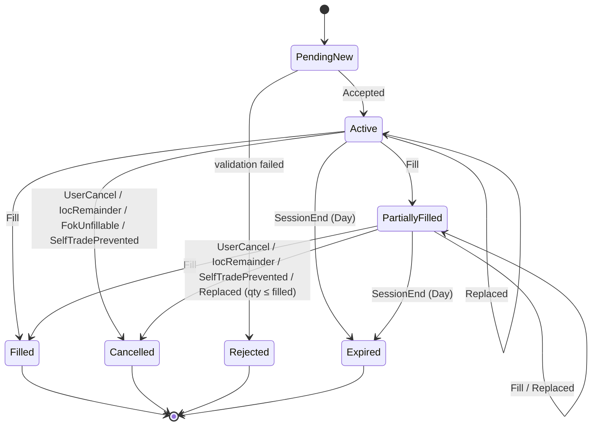
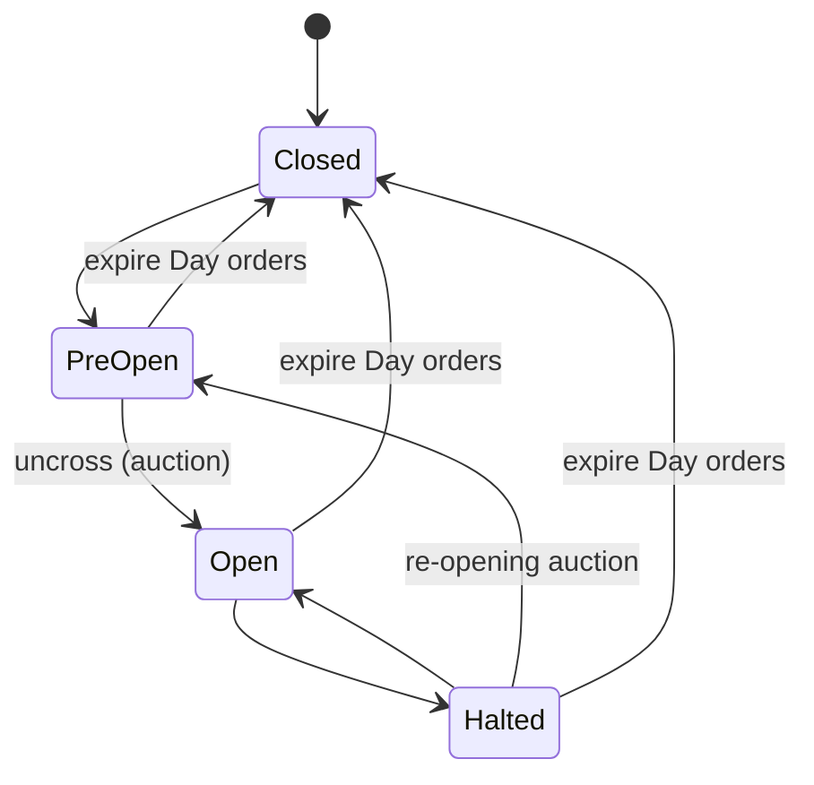

# order_match_book: low-latency limit order book & matching engine

A single-instrument, price-time-priority matching engine in header-only C++20.
It has explicit, table-driven state machines for **order lifecycle** and
**trading session**, makes no heap allocations on the hot path, produces
deterministic output, and is hardened against hostile clients.

```
include/ob/
  types.hpp            ids, prices, enums, Reason codes
  state_machine.hpp    OrderState + SessionState transition tables (constexpr, static_assert'd)
  order.hpp            64-byte cache-line Order, NewOrder, Trade
  matching_engine.hpp  MatchingEngine<Listener>
  listeners.hpp        NullListener, RecordingListener / Event
  detail/
    level_bitmap.hpp   hierarchical occupancy bitmap: O(depth) best-price search
    order_index.hpp    keyed open-addressing (owner, id) -> Order* map
    order_pool.hpp     pre-allocated slab + intrusive free list
src/ob_cli.cpp         stdin-driven CLI that prints every event
tests/                 unit tests, naive reference engine, differential fuzzer
bench/bench.cpp        throughput + serialised-TSC per-command latency
examples/demo.txt      scripted walkthrough
```

## Build & run

```bash
cmake -S . -B build -DCMAKE_BUILD_TYPE=Release && cmake --build build -j
```

```bash
./build/ob_unit_tests && ./build/ob_differential_test 300 4000
```

```bash
./build/ob_cli < examples/demo.txt
```

```bash
./build/ob_bench 10000000 2    # second argument pins the benchmark to that CPU
```

Sanitizer build: `cmake -S . -B build-asan -DOB_SANITIZE=ON -DCMAKE_BUILD_TYPE=Debug`.

## Configuration

| `EngineConfig` field  | Default   | Meaning |
|-----------------------|-----------|---------|
| `min_price`, `max_price` | 1, 1 000 000 | Valid limit prices in ticks (may be negative). Span ≤ 2²⁴. |
| `max_orders`          | 2²⁰       | Maximum simultaneously **resting** orders. |
| `max_order_qty`       | 10⁹       | Per-order cap. `max_orders × max_order_qty < 2⁶³` is enforced, so no quantity sum can overflow. |
| `market_collar_ticks` | 0 (off)   | A market order may trade at most this far through the opposite touch it sees on arrival. |
| `hash_seed`           | 0 (random)| Key for the id index. It never affects output. |

The constructor throws `std::invalid_argument` for any configuration whose
arithmetic could overflow or whose ladder would be unreasonably large.

## State machines

### Order lifecycle



Every change goes through `transition()`, which checks it against
`kOrderTransitions` and calls `listener.on_order(order, from, reason)`. An
illegal transition is an engine bug, not a client error, so it aborts.
Compile-time `static_assert`s pin key properties, e.g. an order cannot be
filled before it is acknowledged, and fills cannot be undone. Every new order
produces exactly one `PendingNew → Active|Rejected` event.

### Trading session



| Session  | New order                                | Modify   | Cancel | Matching |
|----------|------------------------------------------|----------|--------|----------|
| Closed   | rejected                                 | rejected | ✔      | —        |
| PreOpen  | GTC/Day limit only (no IOC/FOK/market)   | ✔        | ✔      | none; book may cross |
| Open     | ✔                                        | ✔        | ✔      | continuous |
| Halted   | rejected                                 | rejected | ✔      | —        |

`Closed → Open` is deliberately illegal. A book left crossed by `PreOpen →
Closed` can only reach `Open` again through another auction.

## Matching rules

* **Price-time priority.** Trades print at the resting (maker) price.
* **Order types:** limit and market. **TIF:** GTC, Day, IOC, FOK. Market
  orders never rest: GTC/Day become IOC.
* **Ids are scoped per owner.** Orders are keyed by `(owner, id)`.
  `cancel`, `modify` and `find` take the owner, and another owner's order
  looks exactly like a non-existent one (`UnknownOrder`), so ids cannot be
  probed across owners. Trades report both owners. An id may be reused once
  its order is terminal; keeping ids unique for the day is the client's job
  (as with FIX `ClOrdID`).
* **Post-only:** rejected (`PostOnlyWouldCross`) if it would take liquidity,
  both on entry and on modify. Post-only with IOC/FOK/market is
  `InvalidFlags`.
* **FOK:** pre-checked against available liquidity at acceptable prices,
  honouring self-trade prevention. If it can't fill completely it goes
  `Active → Cancelled (FokUnfillable)` with no trades.
* **Self-trade prevention (continuous trading):** orders with the same
  non-zero owner never trade. The aggressor's remainder is cancelled
  (`SelfTradePrevented`, i.e. "cancel newest"). Owner 0 is anonymous and
  disables STP. **STP is not applied in the auction:** same-owner orders can
  cross at the uncross price.
* **Modify = cancel/replace with FIX semantics:** the new quantity is the
  *total* order quantity, so open quantity becomes `new_qty − cum`. If
  `new_qty ≤ cum` the order is done (`Cancelled`, reason `Replaced`). This
  makes size reductions safe when fills race the request. Shrinking open
  quantity at the same price keeps time priority. Any price change or size
  increase re-queues the order and, in `Open`, lets it trade as an aggressor.
* **Opening / re-opening auction** (on `PreOpen → Open`): every price in the
  crossed range is a candidate. The engine picks by
  1. maximum executable volume, then
  2. minimum imbalance, then
  3. closest to the reference price (last trade, else midpoint of the crossed range), then
  4. lower price.
  So the clearing price can fall *between* resting levels. Fills are allocated
  by price-time priority on both sides, and auction trades carry
  `Aggressor::None`. Post-only orders entered in PreOpen can trade in the
  auction.
* **Validation order** (first failure wins): session → `InvalidId` (0) →
  `InvalidQty` (0 or > `max_order_qty`) → `InvalidPrice` → `InvalidFlags` →
  `NotAllowedInAuction` → `DuplicateId` (same owner, live orders only) →
  `BookFull` → `PostOnlyWouldCross`. `BookFull` applies only to an order that
  would actually rest. IOC/FOK/market orders, and limit orders certain to fill
  completely, are accepted on a full book, so liquidity can always be taken.

## Listener contract

```cpp
void on_order(const Order&, OrderState from, Reason why);  // order.state is the new state
void on_trade(const Trade&);
void on_reject(OrderId, OwnerId, Command, Reason);           // command rejected; no state change
void on_session(SessionState from, SessionState to);
```

Callbacks run synchronously in the middle of a command. They may call const
queries, which see the in-progress state, but **must not issue commands**:
re-entry aborts. Commands are `noexcept`, so a throwing listener terminates
the process instead of leaving a half-updated book (fail-stop).

## Performance design

* **Price ladder:** a flat array of levels per side, indexed by tick, so
  lookup is O(1). Each level is an intrusive doubly-linked FIFO with an
  aggregate quantity.
* **Best price:** a hierarchical bitmap. Finding the next occupied level
  climbs and descends with `ctz`/`clz` in O(depth), which is 4 words at
  2²⁴ ticks, however sparse the book is.
* **Orders:** 64-byte cache-line structs in a pre-touched slab. Aggressors
  match from the stack and only take a pool slot and index entry if they come
  to rest.
* **Id index:** 16-byte slots, linear probing at load ≤ 0.5, backward-shift
  deletion (no tombstones), keyed murmur3 hash.
* **Events** go to a template `Listener`, with no virtual calls.
  `NullListener` compiles away.
* **Determinism:** no clocks, and no randomness or hash order that reaches
  the output. Replaying a command log reproduces the event log exactly.

Benchmark on a shared 4-vCPU cloud VM (Xeon @ 2.1 GHz), pinned to one core
but with no isolation from the hypervisor: 10M commands (45% add, 45% cancel,
4% modify, 5% IOC, 1% market), producing about 2.4M trades. Latency is
measured with `lfence`/`rdtscp`-serialised TSC reads, with timer overhead
subtracted.

```
throughput: ~16 M commands/s  (~63 ns/command mean)
latency (ns): p50 ~130   p90 ~215   p99 ~410   p99.9 ~560
```

The hardening is roughly neutral for throughput (within run-to-run noise
against the unhardened engine on the same harness). It costs about 10–15 ns
at p50, mostly the keyed hash. p99.99 and max on this machine are dominated by
hypervisor preemption.

## Adversarial hardening

| Attack / defect | Before | After |
|-----------------|--------|-------|
| Crafted order ids collide in the id index (multiplicative hash is invertible) | 20k adds 450× slower; cancels ~30 µs each | keyed murmur3 hash; crafted ids behave like random ones |
| Quantities near 2⁶⁴ wrap level totals (book opens crossed, FOK misjudged) | silent corruption | `max_order_qty`, with the overflow bound checked at construction |
| Full book rejects liquidity-*taking* orders, so it can never drain | deadlock | only orders that would rest are refused |
| FOK from an owner walks every resting order, repeatably | 68 ms per FOK (1M orders) | level-total pass first: 5 µs |
| Sparse wide ladder makes best-price recovery a linear scan | 2.4 µs per op at 2²⁴ ticks | hierarchical bitmap: 41 ns |
| `{INT64_MIN, INT64_MAX}` config / 2²⁸-tick ladder | signed-overflow UB / 16 GiB allocation | rejected at construction |
| Any client can cancel or modify any order and probe others' ids | allowed | ids scoped per owner |
| Modify quantity meaning "new leaves" over-exposes during in-flight fills | 100 − 60 filled → modify 80 ⇒ 140 exposure | FIX total-quantity semantics |
| Market order sweeps the whole ladder | no protection | optional `market_collar_ticks` |
| Listener re-enters the engine or throws | silent corruption | abort / terminate (fail-stop) |

A rejected FOK still costs O(occupied price levels within its limit). Per-owner
order limits and limit-price bands are left to the gateway's risk checks.

## Verification

* **Unit tests** (`tests/unit_tests.cpp`, 38 cases): every order type and
  TIF, priority, STP, modify semantics, owner scoping, collars, validation,
  config overflow guards, session gating, auction pricing (including prices
  between levels and the last-trade reference), Day expiry, a fork-based
  death test for listener re-entry, a hash-flooding regression test, and
  brute-force checks of the bitmap and index.
* **Differential fuzzer** (`tests/differential_test.cpp`): runs the engine
  side by side with a deliberately naive `ReferenceEngine`. The reference
  uses a flat vector and linear scans, and its auction is a brute-force
  search over every integer price. After **every** command the fuzzer
  requires identical return codes, identical event streams and identical book
  contents in priority order, plus a `check_invariants()` structural audit.
  The random streams include invalid input, tiny pools, low quantity caps,
  negative and wide (3-layer bitmap) ladders, collars, cross-owner commands
  and random session transitions. The default run is 1.2M commands and
  reaches every legal state transition and every reject reason.
* **Mutation-tested:** 20 hand-planted bugs across the engine, index and
  bitmap are all caught.
* The test suite is clean under ASan + UBSan.

## Scope / non-goals

One instrument per engine instance and single-threaded: shard by symbol and
feed each engine from a queue. There is no persistence: the deterministic
event log is designed to be journaled. No STP in the auction, and no
iceberg, stop or pegged orders.
